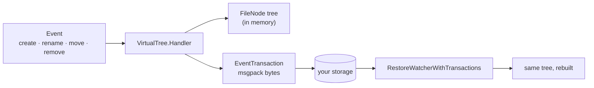

# FS-Shadow Javascript

[](https://app.codacy.com/gh/akdilsiz/fs-shadow-js/dashboard?utm_source=gh&utm_medium=referral&utm_content=&utm_campaign=Badge_grade)
[](https://dl.circleci.com/status-badge/redirect/gh/akdilsiz/fs-shadow-js/tree/main)
[](https://coveralls.io/github/akdilsiz/fs-shadow-js)

A small, dependency-light JavaScript library that keeps a **virtual file
tree** in memory and records every change as a compact **msgpack
transaction**. Store the transactions anywhere and replay them later to
rebuild exactly the same tree. Only the virtual file system is implemented
for now; it never touches the real disk.

Forked from [ayhanozemre/fs-shadow](https://github.com/ayhanozemre/fs-shadow) (Go).

## How it works



- **FileNode** – a folder or file with `Name`, `UUID`, `ParentUUID`, `Meta`
  and `Subs` (children).
- **Event** – what happened: `Create`, `Rename`, `Move` or `Remove`, with
  `VirtualPath` source and target paths.
- **EventTransaction** – the result of one event, encoded as msgpack
  (`Name, Type, UUID, ParentUUID, Meta`). This format is stable, so stored
  transactions keep working across versions.

## Install

```sh
npm install fs-shadow-js
# or
pnpm add fs-shadow-js
```

Requires Node.js 20 or newer (or any modern browser bundler). The package is
ESM only; modules are imported by file path, with the `.js` suffix.

## Usage

```js
import { NewVirtualWatcher } from 'fs-shadow-js'
import { VirtualPath } from 'fs-shadow-js/virtualPath.js'
import { Event, Create, Rename, Move, Remove } from 'fs-shadow-js/event.js'
import { ExtraPayload } from 'fs-shadow-js/types.js'
import { RestoreWatcherWithTransactions } from 'fs-shadow-js/restore.js'

// 1. Create a watcher for the virtual root "docs".
const { watcher, eventTransaction: rootTx } = await NewVirtualWatcher(
  'uuid-root',
  'docs',
  new ExtraPayload('uuid-root', true)
)
const log = [rootTx.Encode().encoded]

// 2. One event: Handler applies it and returns the transaction to store.
//    Encode() returns { encoded: Uint8Array, error }.
const { eventTransaction } = await watcher.Handler(
  new Event(Create, new VirtualPath('docs/reports', true)),
  new ExtraPayload('uuid-reports', true)
)
log.push(eventTransaction.Encode().encoded)

// More events, applied in order (a file must exist before it is renamed).
// ExtraPayload(uuid, isDir, sum, size, createdAt, permission)
const events = [
  [
    new Event(Create, new VirtualPath('docs/q3.pdf')),
    new ExtraPayload('uuid-q3', false, 'sha256-hex', 2048)
  ],
  [
    new Event(
      Rename,
      new VirtualPath('docs/q3.pdf'),
      new VirtualPath('docs/q3-final.pdf')
    )
  ],
  [
    new Event(
      Move,
      new VirtualPath('docs/q3-final.pdf'),
      new VirtualPath('docs/reports', true)
    )
  ]
]

for (const [event, extra] of events) {
  const { eventTransaction } = await watcher.Handler(event, extra)
  log.push(eventTransaction.Encode().encoded)
}

watcher.SearchByPath('docs/reports/q3-final.pdf').UUID // 'uuid-q3'

// 3. Later: rebuild the same tree from the stored transactions.
const { watcher: restored } = await NewVirtualWatcher(
  'uuid-root',
  'docs',
  new ExtraPayload('uuid-root', true)
)
await RestoreWatcherWithTransactions(log, restored)
restored.FileTree.Subs[0].Subs[0].Name // 'q3-final.pdf'

// Removing works the same way.
await watcher.Handler(
  new Event(Remove, new VirtualPath('docs/reports/q3-final.pdf'))
)
```

Paths start with the root name (`docs/...`) and use `/` as the separator.

### Safe file names

`safeFileName` makes a name fit into the per-name byte limit of real file
systems (ext4, APFS and Btrfs reject names over 255 bytes) before you write
it to disk.

```js
import { safeFileName, MaxFileNameBytes } from 'fs-shadow-js/path.js'

safeFileName('report.pdf') // 'report.pdf' (fits, unchanged)
safeFileName('a'.repeat(300) + '.txt') // 240 bytes, ends with '.txt'
safeFileName('ş'.repeat(150), 200) // custom limit: 200 bytes
```

Names that already fit are returned unchanged. Longer names are cut on a
character boundary (multi-byte characters are never split), keep their
extension and get a short deterministic hash, so the same input always gives
the same name and names with a long common prefix stay distinct.

## API at a glance

| Module                        | Main exports                                                                                  |
| ----------------------------- | --------------------------------------------------------------------------------------------- |
| `fs-shadow-js` (`watcher.js`) | `NewVirtualWatcher(rootUUID, rootName, extra)`                                                |
| `watcherVirtual.js`           | `VirtualTree` (`Handler`, `SearchByPath`, `SearchByUUID`, `Restore`), `NewVirtualPathWatcher` |
| `event.js`                    | `Event`, `Create`, `Rename`, `Move`, `Remove`, `Write`, `ValidEvents`                         |
| `virtualPath.js`              | `VirtualPath(path, isDir)`                                                                    |
| `fileNode.js`                 | `FileNode`                                                                                    |
| `eventTransaction.js`         | `EventTransaction` (`Encode`, `Decode`, `ToFileNode`)                                         |
| `restore.js`                  | `RestoreWatcherWithTransactions`, `CreateFileNodeWithTransactions`                            |
| `types.js`                    | `MetaData`, `ExtraPayload`, `DateTypes`                                                       |
| `path.js`                     | `Separator`, `safeFileName`, `MaxFileNameBytes`                                               |
| `errors.js`                   | error message constants such as `ErrFileNodeNotFound`                                         |

TypeScript declarations (`*.d.ts`) ship with the package.

## Security

What the library does:

- **No disk, network or native code.** Everything happens in memory in
  plain JavaScript; there are only two runtime dependencies
  (`@msgpack/msgpack`, `uuid`).
- **Fixed transaction format.** Decoding copies only the known fields into
  the transaction object, and the msgpack decoder rejects `__proto__` keys,
  so a transaction cannot pollute object prototypes.
- **Errors as values.** `Encode()` and `Decode()` return `{ error }` instead
  of throwing on bad input.
- **Safe file names.** `safeFileName` never splits a UTF-8 character and is
  deterministic.
- **Checked on every change.** CI runs lint (oxlint), formatting checks and
  the test suite on Node.js 20 and 24, plus coverage and Codacy static
  analysis.

What you should do as a consumer:

- Treat stored transactions as **untrusted input**: limit their size before
  decoding and always check the returned `error`.
- Run `safeFileName` on names before creating real files from the tree.

Found a vulnerability? Please report it privately through GitHub Security
Advisories instead of opening a public issue.

## Development

```sh
pnpm install          # needs Node.js >= 22.13 (pnpm 11)
pnpm test:all         # tests, run on Node.js 20 and 24 in CI
pnpm lint:check       # oxfmt + oxlint
```

## License

fs-shadow-js is licensed under the MIT. See [LICENSE](LICENSE) for the full
license text.
